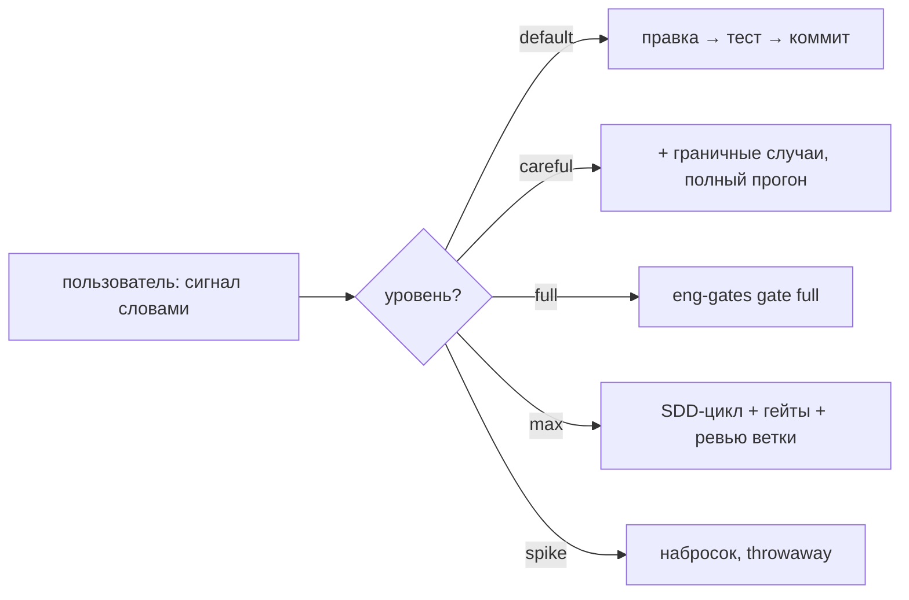

# omp-agent-skills — скиллы для Oh My Pi (omp)

**Коллекция скиллов, не персона.** Агент сам собирает поведение из скиллов —
по их `description` (что умеет) и карте сигналов (когда включать). Персона
как слой — конфиг-оверлей, правки системного промпта, лаунчер — удалена:
она добавляла процесс всем задачам подряд, включая те, которым он не нужен.

## Как это работает

1. **Пользователь задаёт строгость словами** — «тщательно», «все проверки»,
   «оверинжинь» — или молчит (тогда прямой путь: правка → тест → коммит).
   Карта сигналов: [`signals.md`](./signals.md).
2. **Агент берёт скилл, когда триггер совпал** с задачей и уровнем.
   Например, eng-gates включается на «все проверки» или когда гейты уже
   живут в репо и упали — но не «после каждого юнита».
3. **Эскалация вверх — только по сигналу.** Предложить меньший уровень
   можно, навязать больший — никогда.



## Состав

| Скилл | Триггер | Что делает |
|---|---|---|
| [`eng-gates`](./skills/eng-gates/) | «все проверки», production-grade, упавший гейт, init в репо | детерминированные quality-гейты Rust/Python/JS-TS: формат, линт, типы, тесты, границы модулей, CRAP, дубликация, мутации, бенчмарки + guard'ы от ослабления |
| [`reversing`](./skills/reversing/) | артефакт без исходников | bunfs/Mach-O/ELF, минифицированные бандлы, бинарные форматы, протоколы; гипотеза → скрипт → сверка с upstream |
| [`writing-docs`](./skills/writing-docs/) | пользовательский текст | готовая документация с первого черновика: русский без калек, факты с источниками, таблицы |
| [`coordinating`](./skills/coordinating/) | 3+ агента на одной цели | разложение на параллельные юниты без общей записи, волны, статус-таблицы, эскалация |
| `agents/` | — | референс-копии бандлованных агентов omp (scout, reviewer, security-reviewer, sonic, task) для кастомизации |

## Установка

```bash
# omp установлен (https://github.com/can1357/oh-my-pi)
omp --version

# скиллы — в пользовательский каталог omp:
git clone https://github.com/spgsroot/omp-agent-skills.git
cp -r omp-agent-skills/skills/* ~/.omp/agent/skills/

# карта сигналов — глобальный контекст (все сессии):
cp omp-agent-skills/signals.md ~/.omp/agent/AGENTS.md
#   (или допишите блок «Сигналы строгости» в существующий AGENTS.md)

# опционально, для eng-gates: SDD-агенты ревью и инструменты
omp plugin install @loneexile/omp-superpowers
bash ~/.omp/agent/skills/eng-gates/scripts/install-tools.sh --python --ub
```

Требования eng-gates: Python ≥3.11 (tomllib); Windows — `python` вместо
`python3` (заглушка Store), ub-проверки недоступны и репортятся как missing tool.

### Проверка, что скиллы загрузились

```bash
omp -p 'List the skill names available to you, comma-separated'
# ожидание: eng-gates, reversing, writing-docs, coordinating, …
```

## Почему без персоны

Персона (оверлей конфига + `--append-system-prompt` + лаунчер) решала задачу
«дать агенту процесс» статическим слоем — и тем самым вешала SDD-цикл,
гейты и ролевую методологию на каждый запрос. Опыт показал две проблемы:

- **Оверинжиниринг мелочи**: правка одной строки проходила через разведку
  скаутами, план, волны субагентов и полные гейты — платно по токенам и
  времени.
- **Скрытый выбор уровня**: агент решал «это проект или мелочь» сам, и
  пользователь не контролировал, когда включается тяжёлая артиллерия.

Сигнальная модель переворачивает ответственность: **пользователь явно
говорит, когда нужно оверинжинирить и проходить все квалити-чеки**, агент
не эскалирует без команды. Скиллы остаются теми же — меняется только
условие включения.

Анализ токен-затрат персоны (исторический, замеры 2026-10-31):
[`docs/token-costs.md`](./docs/token-costs.md).

## Лицензия

MIT для собственных файлов репо. Скрипты eng-gates включены как есть из
локальной дистрибуции скилла. Плагин superpowers — апстрим
(@loneexile/omp-superpowers, MIT), здесь не вендорится и ставится через omp.