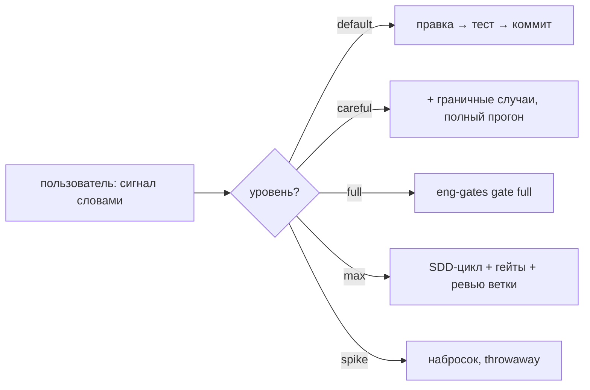

# omp-agent-skills — скиллы для Oh My Pi (omp)

**Коллекция скиллов, не персона.** Агент сам собирает поведение из скиллов —
по их `description` (когда скилл нужен задаче) и карте сигналов (сколько процесса включать).
Персона как слой — конфиг-оверлей, правки системного промпта, лаунчер — удалена:
она добавляла процесс всем задачам подряд, включая те, которым он не нужен.

## Как это работает

1. **Пользователь задаёт строгость словами** — «тщательно», «все проверки»,
   «оверинжинь» — или молчит (тогда прямой путь: правка → тест → коммит).
   Карта сигналов: [`signals.md`](./signals.md).
2. **Предметные скиллы доступны без специальных сигналов**: текст —
   `writing-docs`, артефакт без исходников — `reversing`.
   `eng-gates` включается по запросу проверок или для исправления упавшего
   существующего гейта — не после каждой правки.
3. **Эскалация вверх — только по сигналу.** Предложить меньший уровень
   можно, навязать больший — никогда.



## Состав

| Скилл | Триггер | Что делает |
|---|---|---|
| [`eng-gates`](./skills/eng-gates/) | «все проверки», production-grade, упавший гейт, init в репо | детерминированные quality-гейты Rust/Python/JS-TS: формат, линт, типы, тесты, границы модулей, CRAP, дубликация, мутации, бенчмарки + guard'ы от ослабления |
| [`reversing`](./skills/reversing/) | артефакт без исходников | bunfs/Mach-O/ELF, минифицированные бандлы, бинарные форматы, протоколы; гипотеза → скрипт → сверка с upstream |
| [`writing-docs`](./skills/writing-docs/) | написание, редактура или аудит технического текста | документация и статьи: основания и границы утверждений, логическая проверка, устранение повторов и искусственной драматизации; объём работы по запросу |
| [`coordinating`](./skills/coordinating/) | 3+ агента на одной цели | разложение на параллельные юниты без общей записи, волны, статус-таблицы, эскалация |
| `agents/` | — | референс-копии бандлованных агентов omp (scout, reviewer, security-reviewer, sonic, task) для кастомизации |

## Установка

Сначала выберите постоянное место для клона — оно станет источником скиллов:

```bash
omp --version
git clone https://github.com/spgsroot/omp-agent-skills.git
```

В пользовательском `~/.omp/agent/config.yml` добавьте каталог `skills`
этого клона в `skills.customDirectories`. Используйте **абсолютный путь**;
на Windows удобнее прямые слеши. Существующие элементы списков сохраните:

```yaml
skills:
  customDirectories:
    - /absolute/path/to/omp-agent-skills/skills
  ignoredSkills:
    - using-superpowers
disabledExtensions:
  - extension-module:superpowers
```

`customDirectories` читает скиллы прямо из клона: после обновления и ревью
не требуется повторное копирование. Не устанавливайте одновременно отличающиеся
копии тех же скиллов в `~/.omp/agent/skills/`: omp оставляет вторую версию под
другим именем. Старые копии перенесите в резервную папку **вне каталогов скиллов**.

Карту [`signals.md`](./signals.md) добавьте в пользовательский `AGENTS.md`.
Не заменяйте весь файл командой `cp`: сохраните несвязанные предпочтения,
но удалите прежние безусловные требования SDD и `gate full`.
Старый файл персоны `~/.omp/agent/APPEND_SYSTEM.md`, если он содержит только
персону, также перенесите в резервную папку; если нет — удалите только её блок.
Уберите старые параметры `--config`/`--append-system-prompt` из собственного
лаунчера, если они добавляют персону.

### Superpowers — библиотека, не обязательный процесс

```bash
omp plugin install @loneexile/omp-superpowers
```

Плагин необязателен; он нужен для SDD-скиллов и агентов. Его не нужно целиком
отключать или править в `node_modules`: `extension-module:superpowers`
отключает только расширение, которое вставляет bootstrap. Скиллы и пять
`sdd-*` агентов обнаруживаются отдельно и остаются доступными.
`using-superpowers` исключён из каталога, потому что его триггер требует
bootstrap в начале любого разговора. Остальные скиллы выбираются по задаче;
ссылки между ними не повышают выбранный пользователем уровень строгости.

Эта схема проверена на omp **18.15.0** с `@loneexile/omp-superpowers`
**7.0.1-omp.4**. `agents/` из этого репозитория копировать не нужно:
это справочные снимки бандлованных агентов, а не обязательные переопределения.

Инструменты гейтов устанавливаются отдельно и только при необходимости:

```bash
bash /absolute/path/to/omp-agent-skills/skills/eng-gates/scripts/install-tools.sh --python --ub
```

Требования eng-gates: Python ≥3.11 (`tomllib`). На Windows используйте
`python`, если `python3` указывает на заглушку Store; ub-проверки недоступны
и отмечаются как missing tool. Пропуск из-за missing tool — неполная проверка,
а не доказательство прохождения полного набора гейтов.

### Проверка загрузки

Начните **новую сессию** после изменения контекста и настроек:

```bash
omp skill list --json
omp read skill://eng-gates
omp read skill://coordinating
omp read skill://reversing
omp read skill://writing-docs
```

В списке должны быть все четыре скилла с путями из одного клона, а не старые
дубли. Команды не требуют вызова модели. Для проверки списка SDD-агентов и
собранного системного промпта используйте RPC `get_state` (`dumpTools` и
`systemPrompt`); bootstrap вставляется позже, в обработчике `context`,
поэтому один `get_state` не доказывает его отсутствие.

### Проверки репозитория

```bash
python -m unittest discover -s skills/eng-gates/tests -v
```

Регрессии охватывают удаление и переименование защищённых конфигов, точность
одобрений, ошибочную базу сравнения, изменение настроек без правки исходников,
сохранение и повторную установку runner, UTF-8 и входные данные бенчмарков.
Отдельно проверяются буквальная передача имён файлов npm-инструментам Windows,
точки входа Node без расширения, запуск выбранного Cargo-плагина и завершение
дочерних процессов по тайм-ауту. Переименование не делает старые подавления
новыми, а специальные символы имён не становятся шаблонами поиска Git.

В шаблоне CI событие `push` проверяет всё дерево (`full --all`), а
`pull_request` — изменения относительно целевой ветки. Это не даёт `push`
пропустить проверки, когда `origin/main` уже совпадает с `HEAD`.

## Почему без персоны

Персона (оверлей конфига + `--append-system-prompt` + лаунчер) решала задачу
«дать агенту процесс» статическим слоем — и тем самым вешала SDD-цикл,
гейты и ролевую методологию на каждый запрос. Опыт показал две проблемы:

- **Оверинжиниринг мелочи**: правка одной строки проходила через разведку
  скаутами, план, волны субагентов и полные гейты — платно по токенам и
  времени.
- **Скрытый выбор уровня**: агент решал «это проект или мелочь» сам, и
  пользователь не контролировал, когда включается тяжёлая артиллерия.

Сигнальная модель переворачивает ответственность: **пользователь явно
говорит, когда нужно оверинжинирить и проходить все квалити-чеки**, агент
не эскалирует без команды. Скиллы остаются теми же — меняется только
условие включения.

Анализ токен-затрат персоны (исторический, замеры 2026-10-31):
[`docs/token-costs.md`](./docs/token-costs.md).

## Лицензия

MIT для собственных файлов репо. Скрипты eng-gates включены как есть из
локальной дистрибуции скилла. Плагин superpowers — апстрим
(@loneexile/omp-superpowers, MIT), здесь не вендорится и ставится через omp.